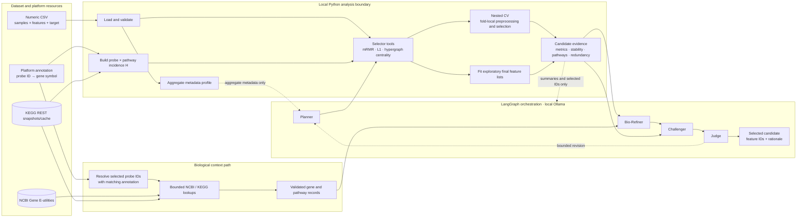
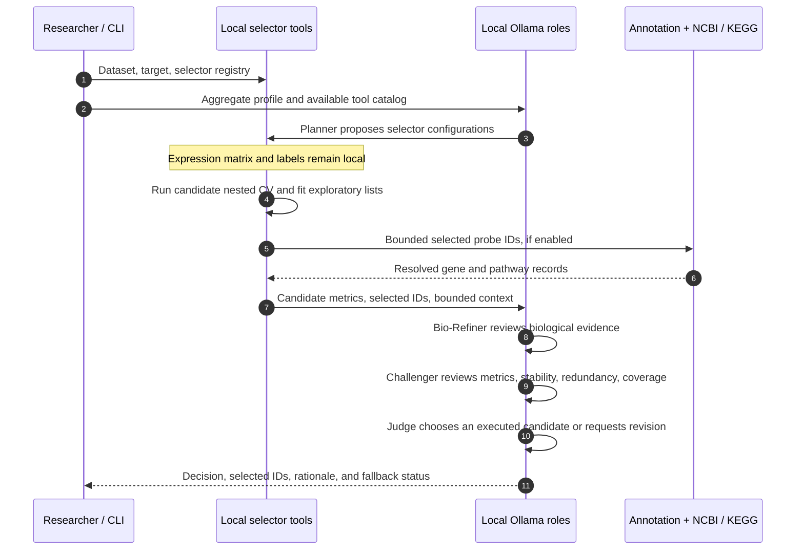

# AgentFS: Local, Pathway-Aware Feature Selection with Agent Orchestration

AgentFS is a research prototype for selecting informative features from
high-dimensional expression data. Its current reference study uses the Golub
Hu6800 microarray dataset to distinguish acute lymphoblastic leukemia (ALL)
from acute myeloid leukemia (AML). The project combines fold-local feature
selection and evaluation, pathway-derived hypergraph structure, platform-aware
gene annotation, and a four-role LangGraph workflow backed by a local Ollama
model.

The project is designed to make candidate feature selection and biological
review traceable. It is **not** a clinical diagnostic system, and the current
implementation does not support every medical data modality.

## What the project does

- Preserves real Hu6800 probe-set identifiers through Golub data processing.
- Profiles datasets with aggregate quality and class-distribution summaries.
- Compares mRMR, L1 logistic selection, and pathway-informed hypergraph
  centrality using nested cross-validation.
- Builds a probe-by-pathway incidence matrix from a matching platform
  annotation and KEGG pathway relationships.
- Resolves selected microarray probes through platform annotation before
  requesting NCBI and KEGG biological context.
- Uses Planner, Bio-Refiner, Challenger, and Judge roles to propose, inspect,
  challenge, and choose among locally executed selector candidates.
- Keeps expression values and sample-level labels in local Python code; the
  local LLM receives bounded feature identifiers and summarized evidence.

Additional research components include biological/statistical redundancy
experiments and an exploratory screened-knockoff selector. They are not all
part of the four-agent demo path.

## Architecture

The analysis path owns the expression matrix and target labels. The biological
context path uses feature identifiers and a platform-matched annotation. The
agent graph sees candidate results and bounded biological records, not the
sample-by-feature matrix.



### Data and privacy boundary

| Data | Used by local Python selectors | Sent to Ollama roles | Sent to NCBI/KEGG |
| --- | --- | --- | --- |
| Expression matrix | Yes | No | No |
| Sample-level labels | Yes | No | No |
| Aggregate profile and class counts | Yes | Yes, as bounded metadata | No |
| Selected probe or feature IDs | Yes | Yes, bounded | Yes, for biological lookup when enabled |
| CV metrics and selector summaries | Yes | Yes | No |
| Resolved gene/pathway context | Yes | Yes, bounded | Returned from lookup |

The local model is accessed through Ollama. Live biological lookups require
network access and use mapped identifiers; expression measurements and sample
labels are not sent to those services.

## Agent execution flow



The Judge must choose a candidate that actually completed local execution. If
all candidate executions fail, the graph reports a fallback with no selected
feature list or CV metrics rather than presenting a configuration proposal as
completed selection. Invalid structured outputs receive bounded retries, and
Judge revision requests have a bounded loop.

## Current agent roles

| Role | Responsibility | Output/use |
| --- | --- | --- |
| Planner | Propose a small set of available selector configurations | Method and feature-count candidates for local execution |
| Local selector tools | Execute proposals with Python selectors and nested CV | Selected IDs, CV summaries, stability, pathway support, redundancy |
| Bio-Refiner | Review executed candidates using resolved gene/pathway records | Biological review and pathway-supported IDs |
| Challenger | Inspect measured evidence and identify concerns | Objections or revision feedback |
| Judge | Choose only from executed candidates or request revision | Final selected set and evidence-backed rationale |

Pydantic V2 schemas validate graph inputs, proposals, contexts, and agent
outputs. Deterministic built-in policies are available for graph use without a
configured model runner; the end-to-end demo uses structured-output Ollama
runners.

## Feature-selection and evaluation design

The core selectors available to the agent workflow are:

| Selector | Role in the workflow |
| --- | --- |
| mRMR | Balances relevance to the target with low pairwise redundancy |
| L1 logistic selection | Uses regularized logistic regression to select a sparse feature set |
| Hypergraph centrality | Uses pathway memberships as higher-order structure over probes |

For a pathway-aware run, a binary incidence matrix `H` links probe rows to
pathway columns. A pathway can connect more than two probes, representing a
group-level biological relation. The matrix is built only when a matching
annotation is provided. The current implementation uses KEGG pathways; it does
not combine Reactome or Gene Ontology networks.

During nested cross-validation, learned preprocessing and feature selection
occur within training folds. The agent demo compares a small number of
candidates and the Judge uses their CV summaries to choose one. Therefore, the
winning candidate's displayed score is **exploratory selection evidence**, not
an unbiased final performance estimate. Use a separate locked evaluation or an
independent cohort for final performance claims. Repeated folds overlap and do
not represent independent studies.

## Dataset scope and identifiers

The default demonstration uses the checked-in Golub Hu6800 export:

- 72 samples, with ALL and AML labels
- 7,129 numeric expression features
- Original Hu6800 / GPL80 probe-set IDs as column names
- Matching GPL80 probe-to-gene-symbol annotation

Golub feature IDs are preserved from a source export that contains them. The
Colon `.mat` data has no supplied probe names; its stable `att_1` through
`att_2000` labels represent source column positions, not verified gene IDs.
Do not send such identifiers to Bio-RAG unless a valid annotation is available.
See [data/reference/README.md](data/reference/README.md) and
[data/annotation/README.md](data/annotation/README.md) for dataset and
annotation provenance.

The agent CLI also accepts other **labeled numeric CSV datasets** with one
sample per row and a target column. For microarray pathway analysis, provide the
matching platform annotation. This interface does not currently handle raw
images, clinical text, arbitrary mixed-type tables, or unlabeled datasets.

## Setup

Use Python 3.11 or newer. From the repository root:

```bash
python3 -m venv .venv
source .venv/bin/activate
python -m pip install --upgrade pip
python -m pip install -e ".[agents,dev]"
```

Install and start Ollama, then download the default local model:

```bash
brew install ollama
brew services start ollama
ollama pull llama3.2
```

For another operating system, install Ollama using its platform-specific
instructions. The model can be changed with `OLLAMA_MODEL`; the Ollama endpoint
can be changed with `OLLAMA_HOST`.

### Optional live Bio-RAG setup

NCBI E-utilities requires an email address. An NCBI API key is optional:

```bash
export NCBI_EMAIL="your-email@example.com"
# Optional:
export NCBI_API_KEY="your-ncbi-api-key"
```

Without `NCBI_EMAIL`, the agent demo skips live Bio-RAG lookups; KEGG-backed
hypergraph selection can still run when an annotation is available. KEGG REST
responses are cached under `data/reference/kegg_snapshot/` after the first
successful request. The first run therefore needs network access unless the
cache is already present.

## Run the project

### Run the four-agent Golub demonstration

From the repository root, ensure Ollama is running and `llama3.2` is available:

```bash
python examples/run_local_agent_graph.py
```

For a run without live NCBI context lookups:

```bash
python examples/run_local_agent_graph.py --bio-rag-limit 0
```

The CLI prints each role's structured output, candidate selector results, the
Judge's selection, and the selected feature IDs. To save the full transcript
for reference:

```bash
python examples/run_local_agent_graph.py 2>&1 | tee demo-output.txt
```

The default CV settings are intentionally short for an interactive demo. They
can be adjusted with `--cv-splits`, `--cv-repeats`, and `--inner-splits`.
Increasing them increases runtime. A demo transcript is run-specific and
should be regenerated after code or data changes.

### Run on another labeled numeric CSV

The CSV must have one sample per row, numeric feature columns, and a target
column. Example:

```bash
python examples/run_local_agent_graph.py \
  --dataset path/to/data.csv \
  --label-column outcome \
  --dataset-id my-dataset \
  --annotation path/to/platform_annotation.tsv \
  --platform GPLxxxx \
  --probe-column "Probe Set ID" \
  --gene-symbol-column "Gene Symbol"
```

Use an annotation whose probe identifiers match the dataset columns. If no
matching annotation is supplied, KEGG hypergraph selection and Bio-RAG are
unavailable for that run; mRMR and L1 remain available.

### Run a bounded probe lookup

For the default GPL80 annotation, set `NCBI_EMAIL` and run:

```bash
python examples/resolve_golub_context.py --limit 5
```

The lookup uses platform-specific probe mappings and records unmapped or
ambiguous identifiers instead of guessing. To write the lookup records as JSON:

```bash
python examples/resolve_golub_context.py --limit 5 --output data/results/probe_lookup.json
```

### Run tests and examples

```bash
python -m pytest -q
python examples/profile_example.py
```

## Repository map

| Path | Purpose |
| --- | --- |
| `src/data_loader.py` | Load supported expression data and apply explicit feature ID mappings |
| `src/agentfs/metadata_profiler.py` | Aggregate-only dataset quality and class profiling |
| `src/agentfs/baseline_selectors.py` | Fold-local mRMR and L1 logistic selectors |
| `src/agentfs/hypergraph_centrality.py` | Pathway-informed hypergraph selector |
| `src/agentfs/hypergraph_experiments.py` | Biological/statistical pathway and redundancy experiments |
| `src/agentfs/evaluation.py` | Nested/repeated CV metrics and selector stability |
| `src/agentfs/tool_registry.py` | Validated selector catalog and local execution tools |
| `src/agentfs/selection_pipeline.py` | Local candidate evaluation and evidence collection |
| `src/agentfs/kegg.py` | KEGG response caching and probe-by-pathway incidence construction |
| `src/agentfs/bio_rag.py` | Platform-aware probe resolution through NCBI/KEGG |
| `src/agentfs/schemas.py` | Pydantic V2 contracts for agents, contexts, and decisions |
| `src/agentfs/agent_graph.py` | Four-role LangGraph and bounded fallback/revision behavior |
| `src/agentfs/ollama_runners.py` | Structured-output local Ollama role runners |
| `examples/run_local_agent_graph.py` | End-to-end local selector and agent demonstration |
| `docs/flow.md` | Implemented architecture and data-flow notes |
| `docs/decisions.md` | Decision history, rationale, evidence, and deferred experiments |

## Limitations and responsible interpretation

- This is a research prototype for feature selection, not a diagnostic product.
- The current integrated demonstration uses a small Golub leukemia dataset.
- The generalized CLI currently supports labeled numeric tabular CSV inputs,
  not every medical dataset or modality.
- Bio-RAG results depend on annotation quality and current external database
  responses. Ambiguous or missing mappings remain unresolved.
- KEGG membership is partial: probes without a mapped gene or pathway do not
  receive pathway memberships.
- Candidate CV metrics are exploratory when used by the Judge to select a
  method; they should not be presented as an independent final estimate.
- A pathway-aware model or agent workflow is not claimed to improve predictive
  accuracy over the baseline without independent supporting evaluation.

## Research documentation

- [Implemented workflow and architecture](docs/flow.md)
- [Decision log and deferred experiments](docs/decisions.md)
- [Month 1 contract and checklist](docs/track_b_month1.md)
- [Hypergraph accuracy experiments](docs/hypergraph_accuracy_experiments.md)
