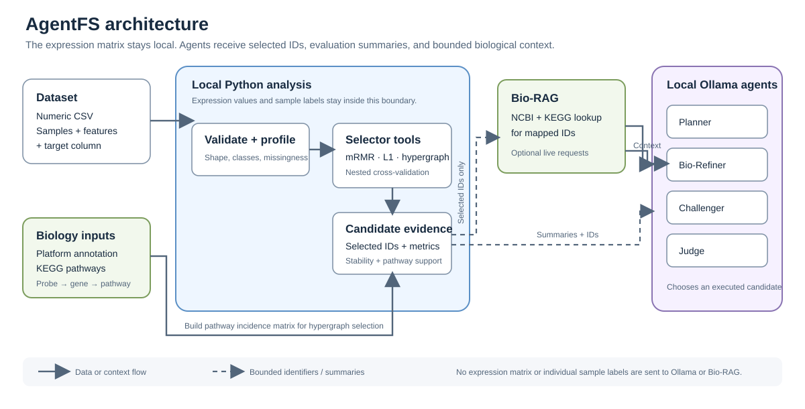
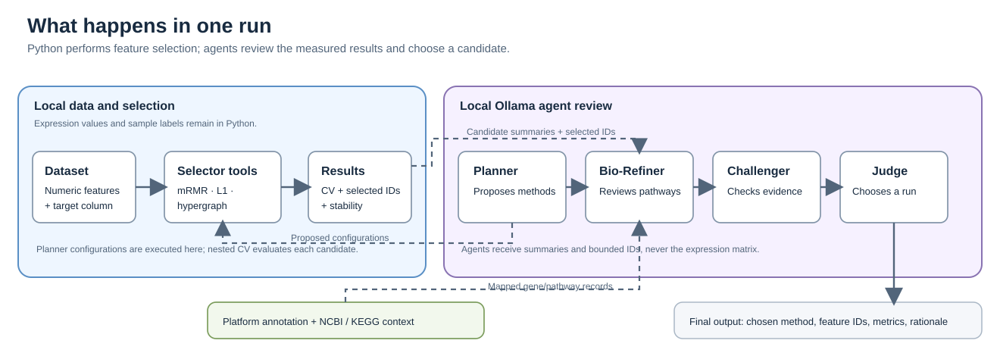

# AgentFS

**AgentFS is a local feature-selection project for high-dimensional expression data.**
It combines statistical selectors, pathway information, and four AI agent roles
to produce and review a candidate feature set.

The current demonstration uses the Golub Hu6800 microarray dataset: 72 samples,
7,129 probe features, and two groups—ALL and AML. This is a research prototype,
not a clinical diagnostic tool. The other-dataset interface currently accepts
labeled numeric CSV files.

## How the project works

The data matrix and sample labels stay in local Python. Only selected feature
IDs, summary metrics, and available gene/pathway context are passed to the
agents. These diagrams are included as image files so they display directly in
GitHub and other Markdown viewers.



### One run, step by step



| Part | What it does |
| --- | --- |
| Planner | Suggests selector methods and feature counts. |
| Local selector tools | Run mRMR, L1 logistic selection, or pathway-informed hypergraph selection. Evaluate candidates with nested cross-validation. |
| Bio-Refiner | Reviews selected features using mapped gene and pathway records when available. |
| Challenger | Checks candidate metrics, stability, redundancy, and pathway coverage. |
| Judge | Chooses among candidates that actually ran and returns the selected IDs and rationale. |

The hypergraph selector represents a pathway as a group of connected probe
features. It can use those groups during selection; it has not been shown to
improve accuracy over the baseline in every run.

## Run the demonstration

### 1. Set up Python

From the repository root:

```bash
python3 -m venv .venv
source .venv/bin/activate
python -m pip install --upgrade pip
python -m pip install -e ".[agents,dev]"
```

### 2. Start the local model

On macOS:

```bash
brew install ollama
brew services start ollama
ollama pull llama3.2
```

The demo uses `llama3.2` by default. Override it with `OLLAMA_MODEL`; set
`OLLAMA_HOST` to use another Ollama endpoint.

### 3. Run the Golub demo

```bash
python examples/run_local_agent_graph.py
```

The script prints the outputs from all four roles, each selector candidate,
the final selected feature IDs, and candidate CV metrics. To save the full
terminal transcript:

```bash
python examples/run_local_agent_graph.py 2>&1 | tee demo-output.txt
```

Bio-RAG live lookups are optional. To enable NCBI lookups, set an email address
in the current terminal session:

```bash
export NCBI_EMAIL="your-email@example.com"
```

Then run the demo. Without `NCBI_EMAIL`, live Bio-RAG is skipped. To skip it
explicitly, use `--bio-rag-limit 0`. KEGG pathway selection can still work
when a matching platform annotation is available; KEGG responses are cached
locally after the first successful request.

### Use another dataset

Provide a CSV with one sample per row, numeric feature columns, and a target
column. For microarray data, supply an annotation that matches the feature IDs:

```bash
python examples/run_local_agent_graph.py \
  --dataset path/to/data.csv \
  --label-column outcome \
  --annotation path/to/platform_annotation.tsv \
  --platform GPLxxxx \
  --probe-column "Probe Set ID" \
  --gene-symbol-column "Gene Symbol"
```

Without a matching annotation, the run can use mRMR and L1 selection, but
platform-specific Bio-RAG and pathway-based hypergraph selection are not
available. Images, clinical text, and unlabeled inputs are not supported by
this interface.

## What the results mean

- The candidate CV scores help the Judge choose a method. They are exploratory,
  not a separate unbiased estimate of final performance.
- Use a separate held-out cohort or locked evaluation for final accuracy
  claims. This project does not claim a clinical diagnosis or a guaranteed
  accuracy improvement.
- The complete feature list can be long. For a presentation, show the winning
  method, a few selected IDs with their mapped context, and the actual metrics;
  keep the full transcript as backup.
- If all local selector candidates fail, the graph marks the run as a fallback
  and returns no selected feature list.

## Dataset and feature IDs

The Golub export keeps the original Hu6800 / GPL80 probe-set IDs as column
names. The Colon `.mat` data has no probe IDs; its `att_1` through `att_2000`
names are column positions, not verified gene identifiers. Bio-RAG requires a
valid matching annotation and does not guess mappings. See
[reference data notes](data/reference/README.md) and
[annotation notes](data/annotation/README.md).

## Tests and useful commands

```bash
python -m pytest -q
python examples/profile_example.py
python examples/resolve_golub_context.py --limit 5
```

`resolve_golub_context.py` performs live lookups and requires `NCBI_EMAIL`.
The test suite does not require NCBI or KEGG live access.

## Where to look in the repository

| Path | Contents |
| --- | --- |
| `src/agentfs/selection_pipeline.py` | Runs local selector candidates and collects their evidence |
| `src/agentfs/agent_graph.py` | Connects Planner, Bio-Refiner, Challenger, and Judge |
| `src/agentfs/tool_registry.py` | Selector catalog and local execution tools |
| `src/agentfs/hypergraph_centrality.py` | Pathway-informed hypergraph selector |
| `src/agentfs/evaluation.py` | Nested/repeated cross-validation and stability metrics |
| `src/agentfs/bio_rag.py` | Platform-aware probe-to-gene and pathway lookups |
| `examples/run_local_agent_graph.py` | End-to-end demonstration |
| `docs/flow.md` | Project architecture and implemented data flow |
| `docs/decisions.md` | Decision history and deferred work |
